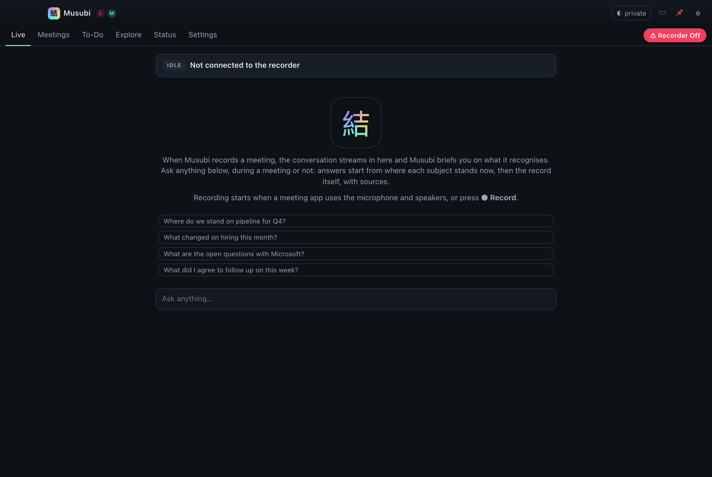
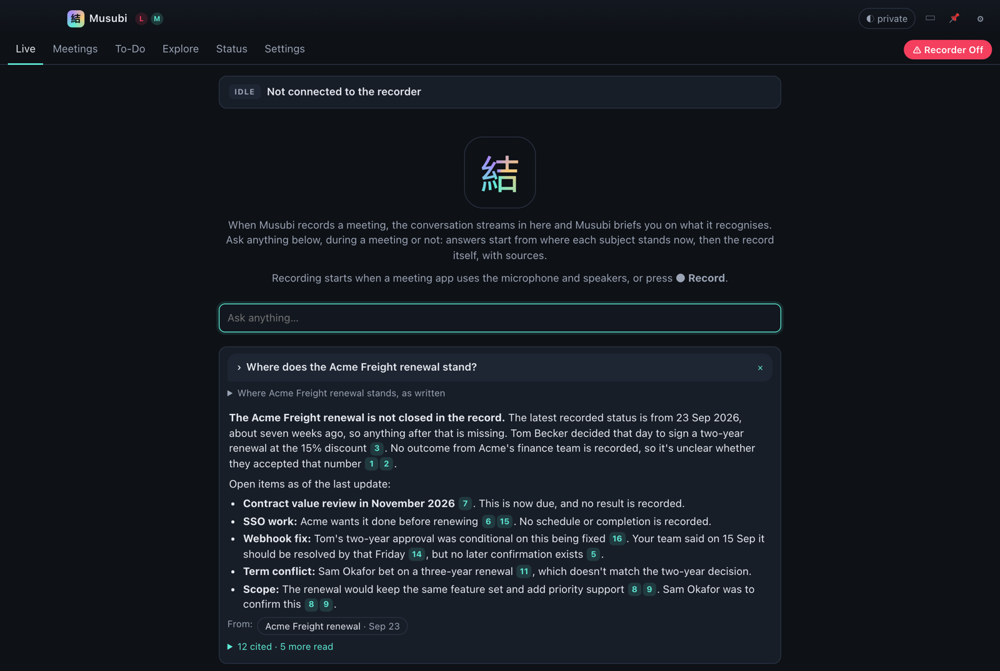
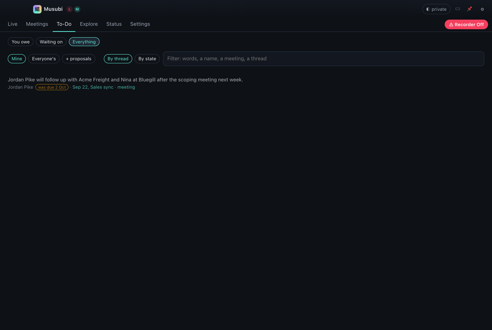
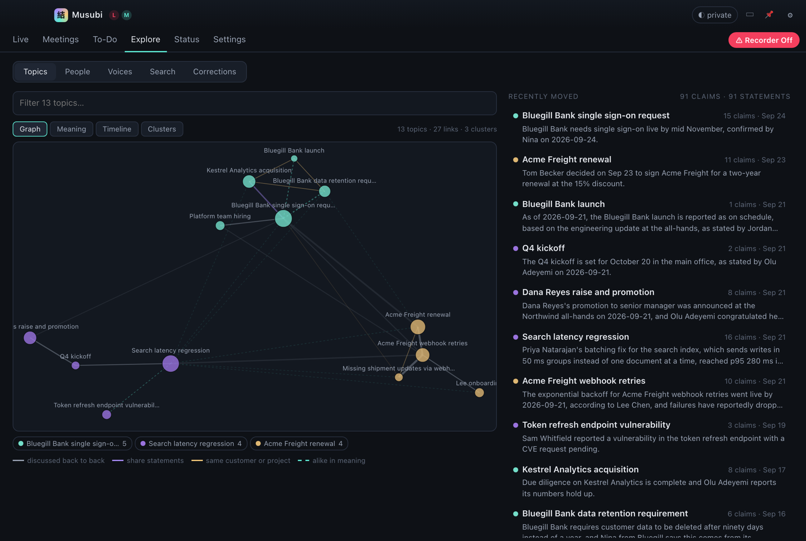
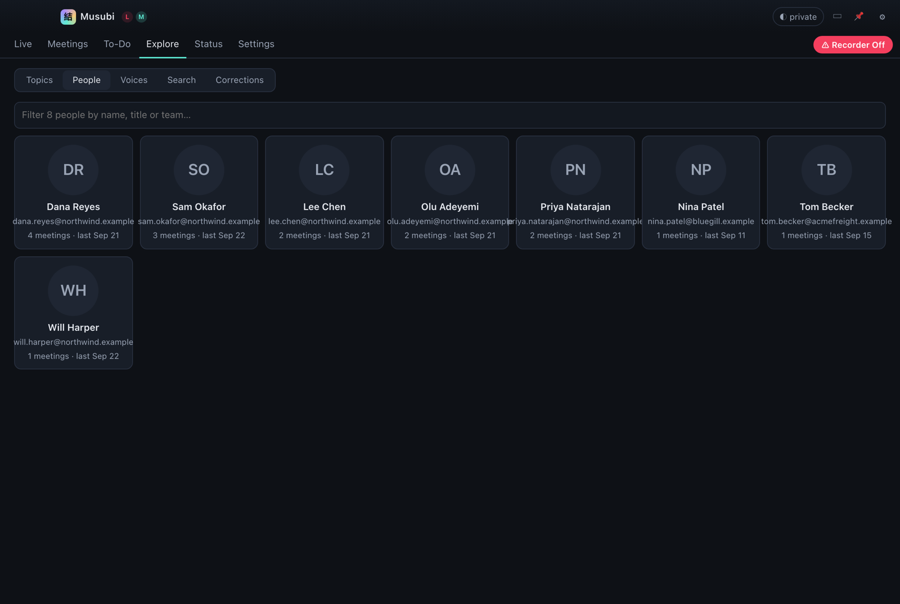
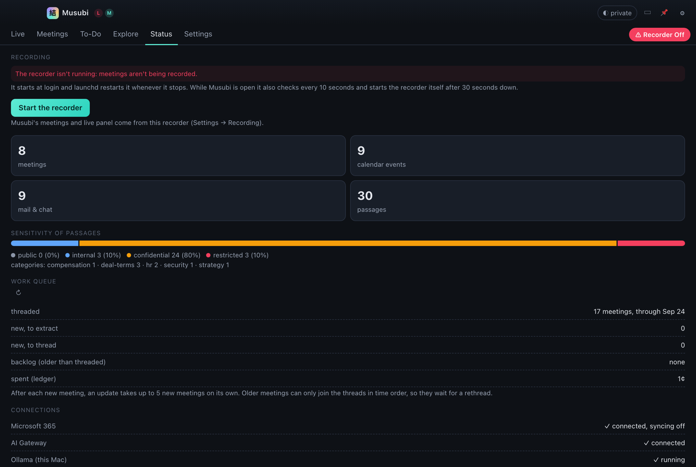

# Musubi user guide

Musubi records your meetings on your Mac, writes down what was said, and
keeps track of what each subject has come to: decisions, open questions,
who owes what. During a meeting it shows what it knows about the subjects
being discussed. Between meetings you can ask it questions, and it answers
with sources.

Everything stays on your Mac, except the text you choose to send to a
hosted model (see [Models](#models)).

The screenshots in this guide use invented demo data: Northwind and its
customers are made up.

- [Quickstart](#quickstart)
- [A tour of the app](#a-tour-of-the-app)
- [Models](#models)
- [Privacy](#privacy)
- [Updating](#updating)
- [When something isn't working](#when-something-isnt-working)

## Quickstart

### 1. What you need

- A Mac with Apple silicon (M1 or later), macOS 14 or later.
- [Ollama](https://ollama.com), installed and opened once. Musubi starts
  it when needed and downloads the local models it uses (about 5.5 GB).
  16 GB of memory or more is best.
- Access to this repository, to download the app.

### 2. Install

1. Download the latest `Musubi-<version>.dmg` from
   [Releases](https://github.com/anielsud/musubi/releases).
2. Open it and drag **Musubi** to **Applications**.
3. Open Musubi from Applications. The app isn't signed by Apple yet, so
   the first time macOS says it can't check it:
   - click **Done**;
   - open **System Settings → Privacy & Security**, scroll down, and
     click **Open Anyway** next to the line about Musubi;
   - confirm with your password or Touch ID.

   You only do this once per version.

### 3. First launch

When Musubi opens for the first time it sets itself up:

- **The recorder.** Musubi installs its recorder, a background app
  (*Musubi Recorder*) that starts when you log in. On its first start it
  downloads its speech models (about 1 GB); **Status** shows the
  progress.
- **Permissions.** macOS asks to let *Musubi Recorder* use the
  **microphone** and **record the screen**. Allow both:
  - the microphone records you;
  - screen recording lets it hear the meeting app's audio (the other
    people) and read speakers' names from the meeting window.

  If you missed a prompt, turn the recorder on in **System Settings →
  Privacy & Security → Microphone** and **→ Screen Recording** (on
  macOS 15 and later, **Screen & System Audio Recording**).

If the red **Recorder off** button by the tabs stays red for more than a
few minutes, see [When something isn't working](#when-something-isnt-working).

### 4. Tell Musubi who you are

**Settings → Accounts → You**: your name and work email. Musubi uses them
to recognise you in calendar invites and transcripts, and to tell your
own commitments from other people's.

### 5. Connect Microsoft 365

Still in **Settings → Accounts**, click **Connect to Microsoft 365**
and sign in with your work account in the browser window that opens.

The first sync reads the last **six weeks** of your calendar and
the Teams transcripts of those meetings, including ones you weren't
recorded in. After that it keeps up on its own. Musubi only reads: it
never sends, changes or deletes anything in Microsoft 365.

To bring in more history before the first sync, raise **First sync,
days back** first.

### 6. Your first meeting

Join a Teams or Zoom call as usual. Recording starts by itself when a
meeting app uses the microphone and speakers. To record something it
didn't notice, press **● Record** by the tabs; press it again to stop.

When the meeting ends, the recording is saved and Musubi reads it: a
summary, to-dos and subjects appear under **Meetings** within a few
minutes.

## A tour of the app

### Live

During a meeting, Live shows the conversation as it happens and briefs
you on the subjects it recognises: where each one stands and what is
still open. While it records, click a speaker's name to rename them.

At any time you can **ask a question** in the box. Answers start from
where each subject stands now, then the record itself, and every answer
links to its sources.

The letters by the name show what's connected: **L**, the live feed from
the recorder; **M**, the local models. Green is connected.

### Meetings

Pick a day in the calendar, or filter by words or people. A meeting shows:

- a short summary, and the subjects it touched;
- what was said, subject by subject, with **where it was said**;
- to-dos from the meeting, and their state now;
- who spoke, with **rename** when a name is wrong;
- **Copy notes** and **Download transcript**.

**Prep for the next one** gathers what to bring to your next meeting:
its subjects, what moved since, and what is still open.

### To-Do

What you agreed to do (**You owe**), what others agreed to do for you
(**Waiting on**), and **Everything**. Each to-do links to the meeting it
came from. Going through new ones, mark each **done** or **not a to-do**;
Musubi keeps your word over what it inferred.

### Explore

- **Topics**: the subjects Musubi follows across meetings, email and
  chat, with the latest movement first. Open one to see its history and
  where it stands.
- **People**: the people you meet, with what you've discussed.
- **Voices**: the voice profiles the recorder has learnt, so it can name
  speakers the meeting window doesn't (turn on **Voice profiles** in
  Settings → Recording first). **Who's this?** lists voices it
  couldn't name for you to name; **Not them** removes a wrong sample.
- **Search**: everything, by words or meaning.
- **Corrections**: the changes you've made, each with undo.

### Status

Whether the recorder is running and recording, how much Musubi holds,
what it's working on, and its connections (Microsoft 365, models). When
something needs you, it says so here first.

### Settings

- **Accounts**: you, and Microsoft 365.
- **AI providers**: where models run: Ollama on this Mac, the recorder's
  speech models, and hosted providers such as the AI Gateway.
- **Models** and **Processing**: which model does each job.
- **Recording**: microphone, meeting audio, reading the meeting window,
  voices and transcription.
- **Dataset**: where your data is, its size, and **Back up now**.

## Models

Out of the box every model runs on your Mac with Ollama: nothing you
record leaves it. Local models are slower, and their summaries and
answers are simpler.

For better results, connect a hosted model:

1. **Settings → AI providers**: add the AI Gateway with your token, or
   another provider.
2. **Settings → Processing → Use recommended**.

Hosted models are then used for reading meetings, summaries, statuses
and answers; search and Live suggestions stay on your Mac.
**Processing** shows what each job costs per meeting hour.

## Privacy

- Recordings, transcripts and everything derived from them stay in
  `~/.local/share/musubi` on your Mac. Nothing is uploaded except the text
  sent to a hosted model you connected.
- Musubi labels what it learns by sensitivity: what is fine for anyone,
  for colleagues, only for the people who were there, or only for you
  (personal details).
- **◐ private** (top right) switches to screen-safe: while you share your
  screen, Musubi shows only what's fine to share.
- Delete a meeting from its page (**Delete meeting…**): it and everything
  learnt from it are removed and never read again.

## Updating

Download the new DMG from
[Releases](https://github.com/anielsud/musubi/releases), quit Musubi, and
drag the new Musubi to Applications, replacing the old one. Don't do it
during a meeting: the recorder restarts with the new version.

Because the app isn't signed by Apple yet, after an update:

- confirm the first open again (**Open Anyway**, as in
  [Install](#2-install));
- macOS may ask again for the microphone and screen recording. If
  recordings come out silent, turn *Musubi Recorder* off and on again in
  **System Settings → Privacy & Security** under both.

## When something isn't working

| What you see | What to do |
|---|---|
| **Recorder off** stays red | Click it to start the recorder. On a new install, wait for the speech models to download (Status). If it still won't start, the reason shows when you hover over the button and on Status. |
| A meeting wasn't recorded | Check **Status → Recording** for the sources. If the other people are missing, allow screen recording for Musubi Recorder (Quickstart, step 3). |
| Speakers are named wrong | Rename them on the meeting's page; the recorder learns their voices. |
| **M** is grey | Ollama isn't running or isn't installed. Open Ollama once. |
| Microsoft 365 says the sign-in has lapsed | **Settings → Accounts → Sign in again**. |

Logs, if someone asks for them: `~/Library/Logs/Musubi/musubi-gui.log`
(the app) and `~/.local/share/musubi/recorder/logs/recorder.log` (the
recorder).

For setting Musubi up from source, the command line and configuration,
see [setup.md](setup.md).
